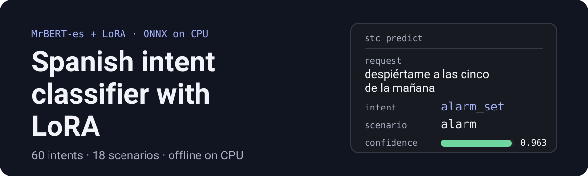
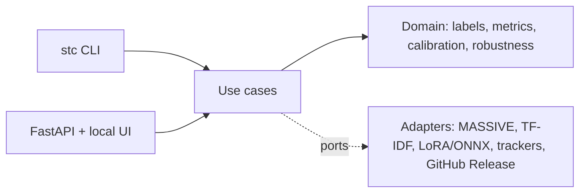
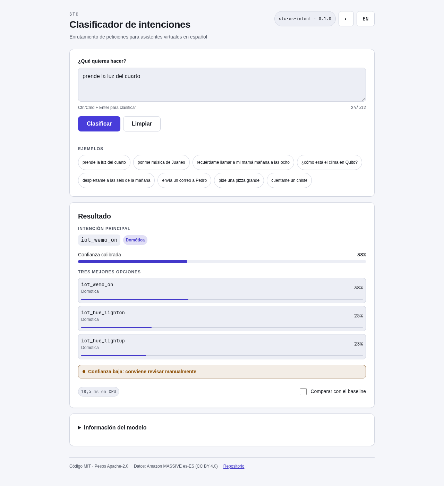
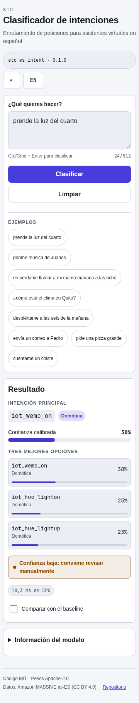
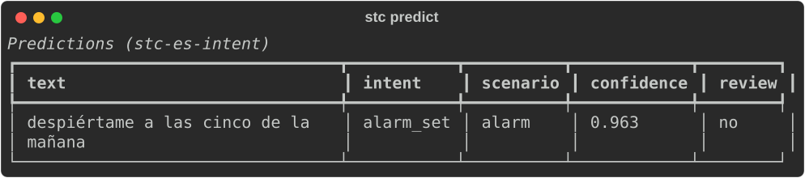

# Spanish intent classifier with LoRA

[Español](README.md) · **English**

<p align="center">
  
</p>

<p align="center"><strong>Routes short Spanish virtual-assistant requests into 60 intents and 18 scenarios, offline and on CPU.</strong></p>

[](https://github.com/Eduardo12Pacheco/clasificador-de-texto-lora/actions/workflows/ci.yml) [](LICENSE) [](pyproject.toml)


## What it is

A classifier for short Spanish virtual-assistant requests. It returns the calibrated intent, its scenario and whether the prediction needs review. Everything runs offline on CPU, from an fp32 ONNX bundle whose sha256 is verified on download.

## Why it is different

- **One audited protocol for every model.** The TF-IDF + LinearSVC baseline and the LoRA fine-tune of `BSC-LT/MrBERT-es` are evaluated under the same protocol: bootstrap CIs, exact McNemar, per-class metrics, calibration and robustness slices.
- **Locked test split.** A data-leakage audit runs before training, and the test split is read only with a capability token and an append-only access log.
- **Calibrated confidence.** Temperature scaling on the shipped model and a `needs_review` threshold chosen on dev, exposed through the CLI, the API and the UI.
- **Published negative results.** The int8 variants failed the pre-registered quantisation gate, so fp32 ships; the result and its measurements are in [ADR-0005](docs/adr/0005-onnx-runtime-inference-and-quantization.md).

## How it works



Hexagonal ports and adapters: a pure domain, application use cases and adapters that never import each other. import-linter and an AST purity test enforce the dependency direction; `mypy --strict` covers `src/`. The module map and the ten named patterns are in [docs/ARCHITECTURE.md](docs/ARCHITECTURE.md).

- **CLI:** `stc predict`, `stc evaluate`, `stc train`, `stc export`, `stc benchmark` and `stc doctor`; every command has `--help` and stable `--json` output.
- **API:** `uv run stc serve` binds `127.0.0.1:19080` and exposes `/healthz`, `/v1/model`, `/v1/labels` and `/v1/predict`, with RFC 7807 errors.
- **UI:** the same command serves a local ES/EN interface with calibrated top-3 bars, a needs-review banner, a baseline comparison toggle and light/dark/system themes. It makes no third-party requests.

| Light | Dark | Mobile (360 px) |
|---|---|---|
|  |  |  |

Error and comparison states are in [docs/assets/ui-error.png](docs/assets/ui-error.png) and [docs/assets/ui-compare.png](docs/assets/ui-compare.png).

## Quickstart

Requirements: Python 3.12 or later and [uv](https://docs.astral.sh/uv/).

Linux and macOS:

```bash
uv tool install "spanish-text-classifier-lora @ https://github.com/Eduardo12Pacheco/clasificador-de-texto-lora/releases/download/v0.1.0/spanish_text_classifier_lora-0.1.0-py3-none-any.whl"
stc model pull
stc predict "despiértame a las cinco de la mañana"
```

Windows PowerShell:

```powershell
uv tool install "spanish-text-classifier-lora @ https://github.com/Eduardo12Pacheco/clasificador-de-texto-lora/releases/download/v0.1.0/spanish_text_classifier_lora-0.1.0-py3-none-any.whl"
stc model pull
stc predict "despiértame a las cinco de la mañana"
```

`stc model pull` downloads the 570 MB fp32 bundle and verifies its sha256. `stc predict` prints the calibrated top intent, its scenario and whether the prediction needs review; `stc model verify` re-checks every bundle hash.



## Results

<!-- RESULTS:START -->

### Results

| Model | Test accuracy (95 % CI) | Test macro-F1 (95 % CI) | ECE before → after |
|---|---|---|---|
| TF-IDF baseline | 0.8410 [0.8268, 0.8534] | 0.8175 [0.7919, 0.8330] | 0.0849 → 0.0253 |
| LoRA transformer | 0.8665 [0.8544, 0.8786] | 0.8305 [0.8064, 0.8458] | 0.0938 → 0.0181 |

The difference in accuracy is statistically significant: the LoRA transformer is more accurate than the TF-IDF baseline on the audited test split (McNemar p = 0.000); the macro-F1 difference is not significant (Δmacro-F1 +0.0131 (95 % CI [-0.0084, +0.0344])).

CPU inference: 15.8 ms p50 / 19.9 ms p95 per utterance at 4 threads (batch-32 throughput 93.2 utterances/s) on 12th Gen Intel(R) Core(TM) i5-12400T. fp32 ONNX bundle: 570.0 MB.

<!-- RESULTS:END -->

The comparison is honest: on the audited test split the transformer is more accurate
than the TF-IDF baseline (the 95 % CI of the accuracy difference excludes zero), but the
macro-F1 difference is not significant. The audit log contains the single release-candidate
test read.

## Honest limitations

- Data and evaluation are European Spanish (`es-ES`). The Latin-American
  regionalisation suite is synthetic and measures sensitivity, not dialect accuracy.
- The audited comparison is a statistical tie: the LoRA point estimate is higher, but
  the paired macro-F1 interval includes zero. The README never claims a proven win.
- All int8 variants failed the quantisation gate, so the shipped 570 MB bundle is fp32;
  the negative result and its measurements are documented in ADR-0005.
- The test split is read only by `stc report final`; one access-log line is committed
  and re-runs are appended, never deleted.
- Status: portfolio project under active maintenance, version 0.1.0. The package is marked `Development Status :: 3 - Alpha` in `pyproject.toml`.

## Documentation

- [Architecture](docs/ARCHITECTURE.md) · [Evaluation protocol](docs/EVALUATION.md) ·
  [Training guide](docs/TRAINING.md) · [Data and licences](docs/DATA.md)
- [CLI reference](docs/CLI.md) · [API guide](docs/API.md) · [Model card](MODEL_CARD.md)
- [Error analysis](docs/ERROR_ANALYSIS.md) · [Decision records](docs/adr/README.md) ·
  [Contributing](CONTRIBUTING.md) · [Security](SECURITY.md)
- Training: needs the optional `train` extra and an 8 GB NVIDIA GPU; inference stays on CPU. The measured pipeline and exact commands are in [docs/TRAINING.md](docs/TRAINING.md).

## Licence and attribution

Code is MIT (`Copyright (c) 2026 Eduardo Pacheco`); released weights are Apache-2.0,
derived from `BSC-LT/MrBERT-es` (Apache-2.0, modification stated in the model card).
Amazon MASSIVE 1.0 and SLURP are CC BY 4.0, Copyright Amazon.com Inc.; the bundled
fixture sample keeps their attribution. See [NOTICE](NOTICE) and
[docs/DATA.md](docs/DATA.md) for the pinned checksum and full lineage.

## Author

Eduardo Pacheco · https://github.com/Eduardo12Pacheco
