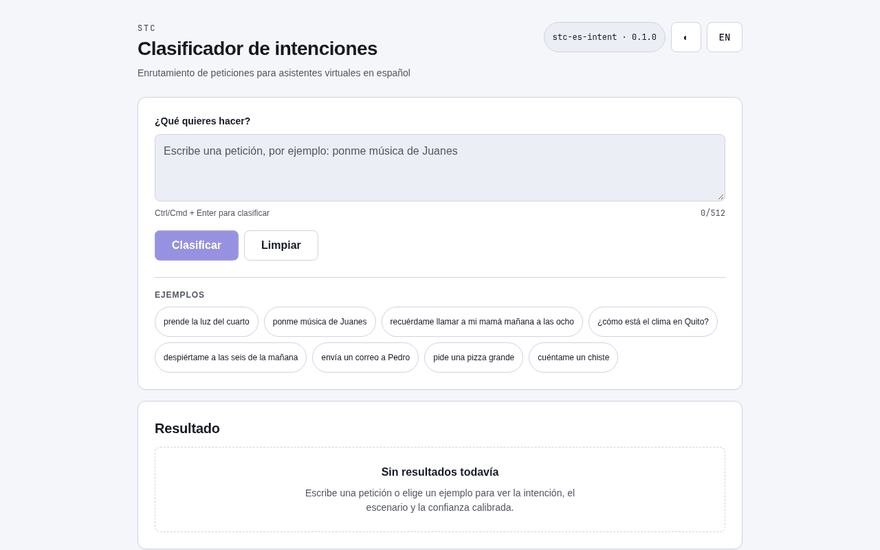
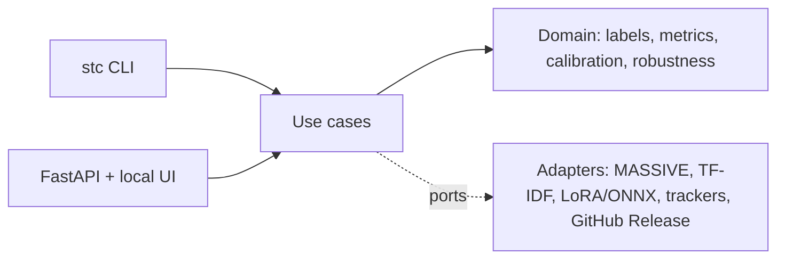
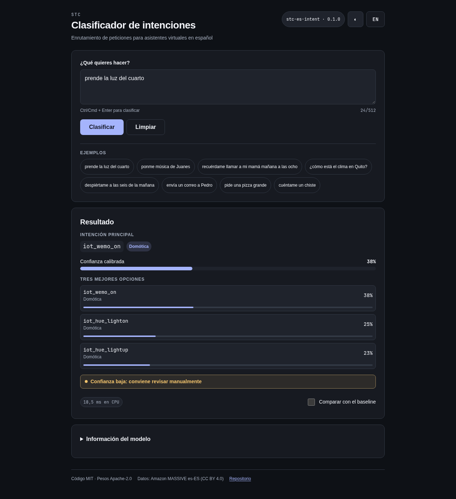

# Spanish intent classifier with LoRA

[Español](README.md) · **English**

Route short Spanish virtual-assistant requests into 60 intents and 18 scenarios with a
LoRA-tuned MrBERT-es encoder and a CPU-only ONNX inference path.

[](https://github.com/Eduardo12Pacheco/clasificador-de-texto-lora/actions/workflows/ci.yml)
[](LICENSE)
[](pyproject.toml)
[](pyproject.toml)
[](#quickstart)



## What it does

- Classifies Spanish assistant utterances into the 60 MASSIVE `es-ES` intents and their
  18 scenarios, fully offline on CPU.
- Compares a tuned TF-IDF + LinearSVC baseline with a LoRA fine-tune of
  `BSC-LT/MrBERT-es` under one audited protocol: bootstrap CIs, exact McNemar,
  per-class metrics, calibration and robustness slices.
- Audits data leakage before training and locks the test split behind a capability
  token plus an append-only access log.
- Calibrates the shipped model with temperature scaling and exposes a dev-chosen
  `needs_review` threshold through the CLI, the API and the UI.
- Ships an fp32 ONNX bundle whose sha256 is verified on download, with int8 variants
  measured against a pre-registered quality gate (all failed, so fp32 ships).

## Results

<!-- RESULTS:START -->

### Results

| Model | Test accuracy (95 % CI) | Test macro-F1 (95 % CI) | ECE before → after |
|---|---|---|---|
| TF-IDF baseline | 0.8410 [0.8268, 0.8534] | 0.8175 [0.7919, 0.8330] | 0.0849 → 0.0253 |
| LoRA transformer | 0.8665 [0.8544, 0.8786] | 0.8305 [0.8064, 0.8458] | 0.0938 → 0.0181 |

The difference in accuracy is statistically significant: the LoRA transformer is more accurate than the TF-IDF baseline on the audited test split (McNemar p = 0.000); the macro-F1 difference is not significant (Δmacro-F1 +0.0131 (95 % CI [-0.0084, +0.0344])).

CPU inference: 15.8 ms p50 / 19.9 ms p95 per utterance at 4 threads (batch-32 throughput 93.2 utterances/s) on 12th Gen Intel(R) Core(TM) i5-12400T. fp32 ONNX bundle: 570.0 MB.

<!-- RESULTS:END -->

The comparison is honest: on the audited test split the transformer is more accurate
than the TF-IDF baseline (the 95 % CI of the accuracy difference excludes zero), but the
macro-F1 difference is not significant. The audit log contains the single release-candidate
test read.

## Architecture

Hexagonal ports and adapters: a pure domain, application use cases and adapters that
never import each other. The dependency direction is enforced by import-linter and an
AST purity test; `mypy --strict` covers `src/`.



See [docs/ARCHITECTURE.md](docs/ARCHITECTURE.md) for the module map and the ten named
patterns, and [docs/adr/](docs/adr/README.md) for the decision records.

## Quickstart

Linux and macOS:

```bash
uv tool install "spanish-text-classifier-lora @ https://github.com/Eduardo12Pacheco/clasificador-de-texto-lora/releases/download/v0.1.0/spanish_text_classifier_lora-0.1.0-py3-none-any.whl"
stc model pull
stc predict "despiértame a las cinco de la mañana"
```

Windows PowerShell:

```powershell
uv tool install "spanish-text-classifier-lora @ https://github.com/Eduardo12Pacheco/clasificador-de-texto-lora/releases/download/v0.1.0/spanish_text_classifier_lora-0.1.0-py3-none-any.whl"
stc model pull
stc predict "despiértame a las cinco de la mañana"
```

`stc predict` prints the calibrated top intent, its scenario and whether the prediction
needs review. `stc model verify` re-checks every bundle hash.

## CLI, API and UI


- CLI: `stc predict`, `stc evaluate`, `stc train`, `stc export`, `stc benchmark`,
  `stc doctor`; every command has `--help` and stable `--json` output.
- API: `uv run stc serve` binds `127.0.0.1:19080` and exposes `/healthz`, `/v1/model`,
  `/v1/labels` and `/v1/predict` with RFC 7807 errors.
- UI: the same command serves a local ES/EN interface with calibrated top-3 bars,
  a needs-review banner, a baseline comparison toggle and light/dark/system themes.

| Light | Dark | Mobile (360 px) |
|---|---|---|
|  |  |  |

Error and comparison states are in [docs/assets/ui-error.png](docs/assets/ui-error.png)
and [docs/assets/ui-compare.png](docs/assets/ui-compare.png). The UI makes no
third-party requests.

## Training

Training needs the optional `train` extra and an 8 GB NVIDIA GPU; inference stays on
CPU. The measured pipeline (screening, full fine-tuning reference, 24-trial Optuna
search and three final seeds) and the exact commands are in
[docs/TRAINING.md](docs/TRAINING.md). Every reported number is produced by a committed
command: see [docs/EVALUATION.md](docs/EVALUATION.md).

## Limitations and honesty

- Data and evaluation are European Spanish (`es-ES`). The Latin-American
  regionalisation suite is synthetic and measures sensitivity, not dialect accuracy.
- The audited comparison is a statistical tie: the LoRA point estimate is higher, but
  the paired macro-F1 interval includes zero. The README never claims a proven win.
- All int8 variants failed the quantisation gate, so the shipped 570 MB bundle is fp32;
  the negative result and its measurements are documented in ADR-0005.
- The test split is read only by `stc report final`; one access-log line is committed
  and re-runs are appended, never deleted.

## Documentation

- [Architecture](docs/ARCHITECTURE.md) · [Evaluation protocol](docs/EVALUATION.md) ·
  [Training guide](docs/TRAINING.md) · [Data and licences](docs/DATA.md)
- [CLI reference](docs/CLI.md) · [API guide](docs/API.md) · [Model card](MODEL_CARD.md)
- [Error analysis](docs/ERROR_ANALYSIS.md) · [Decision records](docs/adr/README.md) ·
  [Contributing](CONTRIBUTING.md) · [Security](SECURITY.md)

## Licence and attribution

Code is MIT (`Copyright (c) 2026 Eduardo Pacheco`); released weights are Apache-2.0,
derived from `BSC-LT/MrBERT-es` (Apache-2.0, modification stated in the model card).
Amazon MASSIVE 1.0 and SLURP are CC BY 4.0, Copyright Amazon.com Inc.; the bundled
fixture sample keeps their attribution. See [NOTICE](NOTICE) and
[docs/DATA.md](docs/DATA.md) for the pinned checksum and full lineage.
