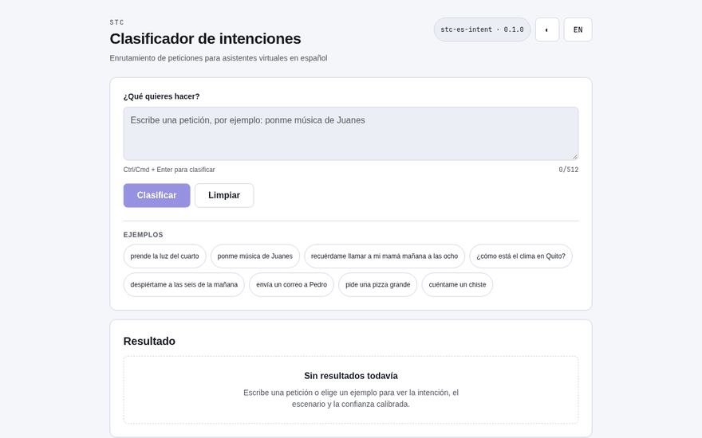
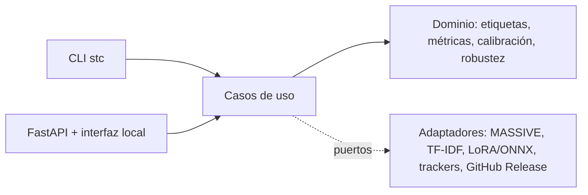
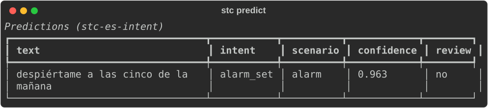
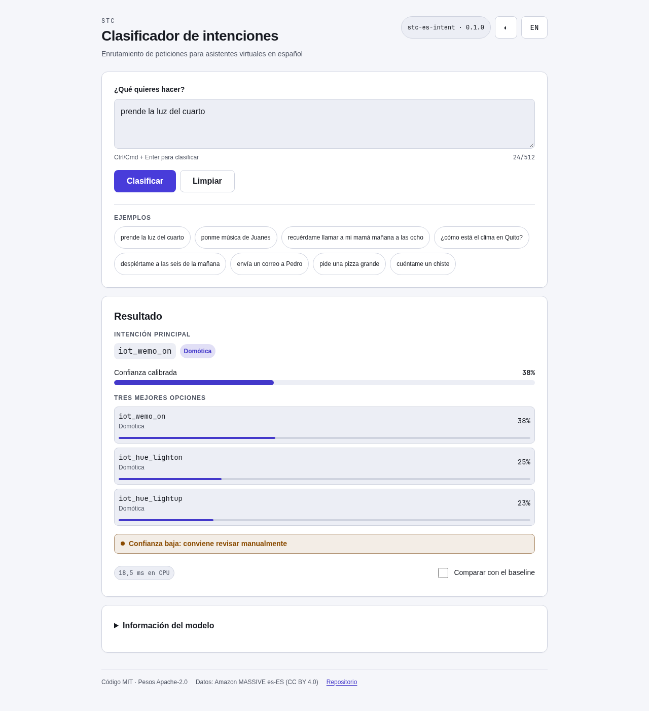
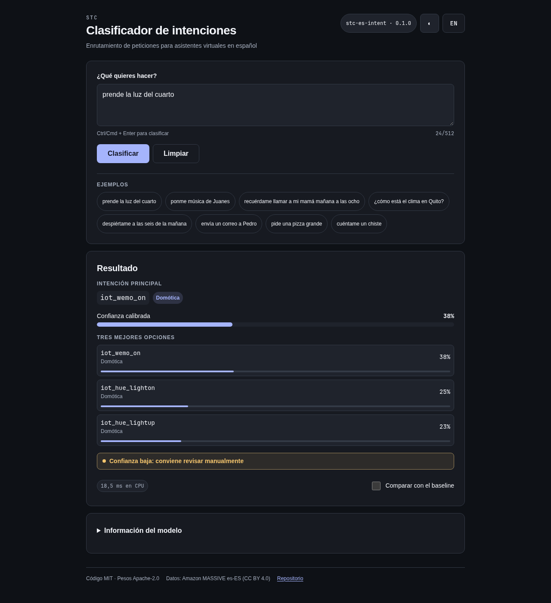
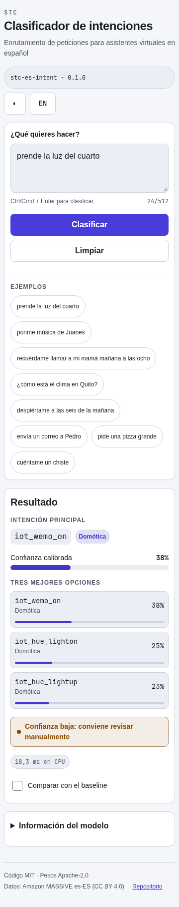

# Clasificador de intenciones en español con LoRA

Enruta peticiones breves de asistentes virtuales en español hacia 60 intenciones y 18
escenarios con un encoder MrBERT-es ajustado con LoRA y una ruta de inferencia ONNX
solo para CPU.

[](https://github.com/Eduardo12Pacheco/clasificador-de-texto-lora/actions/workflows/ci.yml)
[](LICENSE)
[](pyproject.toml)
[](pyproject.toml)
[](#inicio-rápido)



## Qué hace

- Clasifica enunciados de asistente en español hacia las 60 intenciones `es-ES` de
  MASSIVE y sus 18 escenarios, de forma totalmente offline y en CPU.
- Compara una línea base TF-IDF + LinearSVC ajustada con un fine-tune LoRA de
  `BSC-LT/MrBERT-es` bajo un mismo protocolo auditado: intervalos bootstrap, McNemar
  exacto, métricas por clase, calibración y cortes de robustez.
- Audita la fuga de datos antes de entrenar y bloquea el conjunto de test tras un token
  de capacidad y un registro de accesos de solo anexar.
- Calibra el modelo publicado con temperature scaling y expone un umbral
  `needs_review` elegido en dev mediante la CLI, la API y la interfaz.
- Publica un bundle ONNX fp32 cuyo sha256 se verifica al descargar, con variantes int8
  medidas contra una puerta de calidad preregistrada (todas fallaron; se publica fp32).

## Resultados

<!-- RESULTS:START -->

### Resultados

| Model | Test accuracy (95 % CI) | Test macro-F1 (95 % CI) | ECE before → after |
|---|---|---|---|
| TF-IDF baseline | 0.8410 [0.8268, 0.8534] | 0.8175 [0.7919, 0.8330] | 0.0849 → 0.0253 |
| LoRA transformer | 0.8665 [0.8544, 0.8786] | 0.8305 [0.8064, 0.8458] | 0.0938 → 0.0181 |

La diferencia de exactitud es estadísticamente significativa: el transformer con LoRA es más exacto que la línea base TF-IDF en el test auditado (McNemar p = 0.000); la diferencia de macro-F1 no es significativa (Δmacro-F1 +0.0131 (95 % CI [-0.0084, +0.0344])).

Inferencia en CPU: 15.8 ms p50 / 19.9 ms p95 por frase con 4 hilos (rendimiento batch-32 de 93.2 frases/s) en 12th Gen Intel(R) Core(TM) i5-12400T. Bundle ONNX fp32 de 570.0 MB.

<!-- RESULTS:END -->

La comparación es honesta: en el test auditado el transformer es más exacto que la línea
base TF-IDF (el IC 95 % de la diferencia de exactitud no incluye cero), pero la diferencia de
macro-F1 no es significativa. El registro de accesos contiene la única lectura de test de la
release.

## Arquitectura

Puertos y adaptadores hexagonales: un dominio puro, casos de uso de aplicación y
adaptadores que nunca se importan entre sí. La dirección de dependencias la imponen
import-linter y un test AST de pureza; `mypy --strict` cubre `src/`.



Consulta [docs/ARCHITECTURE.md](docs/ARCHITECTURE.md) para el mapa de módulos y los
diez patrones nombrados, y [docs/adr/](docs/adr/README.md) para las decisiones.

## Inicio rápido

Linux y macOS:

```bash
uv tool install "spanish-text-classifier-lora @ https://github.com/Eduardo12Pacheco/clasificador-de-texto-lora/releases/download/v0.1.0/spanish_text_classifier_lora-0.1.0-py3-none-any.whl"
stc model pull
stc predict "despiértame a las cinco de la mañana"
```

Windows PowerShell:

```powershell
uv tool install "spanish-text-classifier-lora @ https://github.com/Eduardo12Pacheco/clasificador-de-texto-lora/releases/download/v0.1.0/spanish_text_classifier_lora-0.1.0-py3-none-any.whl"
stc model pull
stc predict "despiértame a las cinco de la mañana"
```

`stc predict` muestra la intención principal calibrada, su escenario y si la predicción
necesita revisión. `stc model verify` vuelve a comprobar todos los hashes del bundle.

## CLI, API e interfaz



- CLI: `stc predict`, `stc evaluate`, `stc train`, `stc export`, `stc benchmark`,
  `stc doctor`; cada comando tiene `--help` y salida `--json` estable.
- API: `uv run stc serve` escucha en `127.0.0.1:19080` y expone `/healthz`, `/v1/model`,
  `/v1/labels` y `/v1/predict` con errores RFC 7807.
- Interfaz: el mismo comando sirve una UI local ES/EN con barras top-3 calibradas, aviso
  de revisión, comparación con la línea base y temas claro/oscuro/sistema.

| Claro | Oscuro | Móvil (360 px) |
|---|---|---|
|  |  |  |

Los estados de error y comparación están en
[docs/assets/ui-error.png](docs/assets/ui-error.png) y
[docs/assets/ui-compare.png](docs/assets/ui-compare.png). La interfaz no hace peticiones
a terceros.

## Entrenamiento

El entrenamiento necesita el extra opcional `train` y una GPU NVIDIA de 8 GB; la
inferencia permanece en CPU. El pipeline medido (screening, referencia de fine-tuning
completo, búsqueda Optuna de 24 trials y tres semillas finales) y los comandos exactos
están en [docs/TRAINING.md](docs/TRAINING.md). Cada número publicado lo produce un
comando versionado: consulta [docs/EVALUATION.md](docs/EVALUATION.md).

## Limitaciones y honestidad

- Los datos y la evaluación son español de España (`es-ES`). La suite de
  regionalización latinoamericana es sintética y mide sensibilidad, no precisión
  dialectal.
- La comparación auditada es un empate estadístico: la estimación puntual de LoRA es
  mayor, pero el intervalo pareado de macro-F1 incluye cero. El README nunca afirma una
  victoria demostrada.
- Todas las variantes int8 fallaron la puerta de cuantización, así que el bundle
  publicado de 570 MB es fp32; el resultado negativo y sus medidas están en ADR-0005.
- El conjunto de test solo lo lee `stc report final`; hay una línea de acceso
  versionada y las re-ejecuciones se anexan, nunca se borran.

## Documentación

- [Arquitectura](docs/ARCHITECTURE.md) · [Protocolo de evaluación](docs/EVALUATION.md) ·
  [Guía de entrenamiento](docs/TRAINING.md) · [Datos y licencias](docs/DATA.md)
- [Referencia de CLI](docs/CLI.md) · [Guía de API](docs/API.md) · [Model card](MODEL_CARD.md)
- [Análisis de errores](docs/ERROR_ANALYSIS.md) · [Decisiones](docs/adr/README.md) ·
  [Contribuir](CONTRIBUTING.md) · [Seguridad](SECURITY.md)

## Licencia y atribución

El código es MIT (`Copyright (c) 2026 Eduardo Pacheco`); los pesos publicados son
Apache-2.0, derivados de `BSC-LT/MrBERT-es` (Apache-2.0, modificación declarada en la
model card). Amazon MASSIVE 1.0 y SLURP son CC BY 4.0, Copyright Amazon.com Inc.; la
muestra incluida conserva su atribución. Consulta [NOTICE](NOTICE) y
[docs/DATA.md](docs/DATA.md) para el checksum fijado y el linaje completo.
