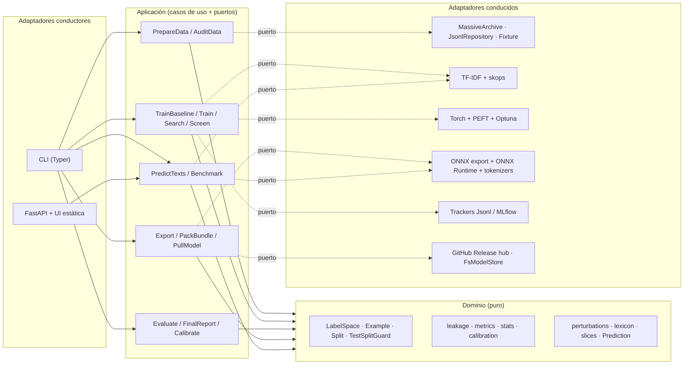
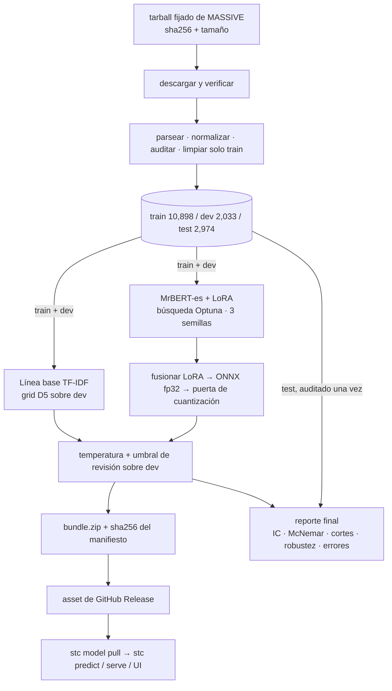

# Arquitectura

## Propósito y restricciones

`spanish-text-classifier-lora` es un clasificador local-first de intenciones para asistentes
virtuales en español. Publica un modelo ONNX Runtime solo para CPU detrás de una CLI con Typer, un
servicio FastAPI y una interfaz web estática. La arquitectura es un diseño hexagonal (puertos y
adaptadores): las reglas puras viven en el dominio, los casos de uso dependen de protocolos y toda
preocupación de E/S (archivos, sklearn, ONNX Runtime, HTTP, argparse) está en un adaptador.

Restricciones vinculantes del plan del proyecto (D1–D24):

- Python 3.12, layout `src/`, `mypy --strict` sobre `src/` y Ruff para lint y formato.
- La inferencia en runtime usa `onnxruntime` y `tokenizers`; `torch` es un extra opcional de
  entrenamiento y el runtime instalado nunca debe importarlo.
- El conjunto de test solo lo leen dos casos de uso auditados, mediante un token de capacidad y un
  registro de solo anexar.
- Todos los artefactos son locales: el tarball fijado de MASSIVE se descarga y se verifica, y los
  pesos se distribuyen mediante GitHub Releases y se verifican por sha256.
- La selección de modelo, la calibración y la puerta de cuantización usan solo dev; test se toca una
  vez por release candidate.

## Capas y dirección de dependencias

```
stc.config · stc.logging · stc.bootstrap        (composición, fuera del anillo)
                    │
                    ▼
adapters  ──implementa──▶  application  ──usa──▶  domain
(cli, api, data, models, inference, training,     (reglas puras: sin E/S)
 export, tracking, reporting, hub, storage, text, web)
```

`domain` solo puede importar la biblioteca estándar y NumPy. `application` puede importar `domain` y
sus propios puertos y DTOs. `adapters` puede importar `application` y `domain`, pero nunca otro
adaptador. `stc.bootstrap` es el composition root y el único módulo autorizado a conectar adaptadores
entre sí; importa de forma diferida las bibliotecas pesadas de entrenamiento y lanza
`MissingExtraError` cuando falta el extra `train`.



## Mapa de módulos

Una línea por paquete; los archivos citados son los puntos de entrada que un recién llegado debe
abrir primero.

- `src/stc/domain` — entidades y reglas puras: etiquetas, ejemplos, particiones, limpieza contra
  fugas, métricas, estadística, calibración, perturbaciones, léxico y cortes. Sin acceso a archivos,
  red, modelos ni configuración. Archivos clave: `src/stc/domain/labels.py`,
  `src/stc/domain/leakage.py`, `src/stc/domain/metrics.py`, `src/stc/domain/calibration.py`.
- `src/stc/application` — puertos (`src/stc/application/ports.py`) y DTOs inmutables
  (`src/stc/application/dto.py`). Es responsable de la inversión de dependencias de todo el proyecto.
- `src/stc/application/use_cases` — orquestación: preparar y auditar datos, entrenar la línea base y el
  transformer, screening y búsqueda, evaluar, componer el reporte final, calibrar, exportar, empaquetar
  y descargar, predecir y medir el rendimiento. Cada caso de uso recibe sus puertos por el constructor.
- `src/stc/application/services` — ayudantes puros de aplicación: los decoradores `ClassifierFactory`
  (selección de estrategia según el tipo de artefacto), `DevOnlyRepository` y `CalibratedClassifier`,
  las reglas de selección de línea base y backbone, `ModelResolver` y `TrackerFactory`.
- `src/stc/adapters/data` — descarga y verificación del archivo fijado de MASSIVE, parseo estricto de
  JSONL, repositorio determinista de particiones procesadas y el repositorio de la muestra incluida.
- `src/stc/adapters/text` — `HfTokenizer` sobre el archivo `tokenizers` de Rust, con truncado por la
  derecha y padding dinámico. Lo comparten el entrenamiento y la inferencia.
- `src/stc/adapters/models` — entrenador y clasificador de la línea base TF-IDF + lineal, y el almacén
  `skops` con lista de tipos permitidos.
- `src/stc/adapters/inference` — verificación del manifiesto y manejo seguro de zips
  (`src/stc/adapters/inference/bundle_io.py`), además del `OnnxClassifier` sin torch
  (`src/stc/adapters/inference/onnx_classifier.py`).
- `src/stc/adapters/training` — el único paquete que importa torch, transformers, PEFT y Optuna:
  semillas, batching, el trainer LoRA o de fine-tuning completo, checkpoints, screening, búsqueda TPE y
  el backbone diminuto de test.
- `src/stc/adapters/export` — exportación a ONNX del LoRA fusionado, verificación de paridad y la matriz
  de cuantización D12 con la puerta de calidad vinculante.
- `src/stc/adapters/tracking` — trackers de experimentos JSONL, MLflow, Null Object y Composite.
- `src/stc/adapters/reporting` — escritores deterministas de JSON, CSV y Markdown, figuras opcionales con
  matplotlib y el renderizador de resultados y resumen.
- `src/stc/adapters/hub` — registro de modelos versionado y descargador de GitHub Release con
  verificación de sha256 y rechazo sin conexión.
- `src/stc/adapters/storage` — almacén de modelos instalados y el escritor de solo anexar
  `reports/test_access_log.jsonl`.
- `src/stc/adapters/cli` — aplicación Typer (`src/stc/adapters/cli/app.py`), módulos de comandos bajo
  `src/stc/adapters/cli/commands`, renderizado con Rich y el mapeo de errores D16. La referencia generada
  es `docs/CLI.md`.
- `src/stc/adapters/api` — fábrica de la aplicación FastAPI, rutas, esquemas de Pydantic, manejadores
  RFC 7807, middleware de request-id y de seguridad, y el proveedor del clasificador.
- `src/stc/adapters/web/static` — módulos ES de JavaScript sin framework, tokens de diseño en CSS,
  catálogos ES/EN y la página que sirve `stc serve`; sin paso de compilación y sin CDN.
- `src/stc/config.py` — ajustes tipados `STC_*` (D15) con el rango de puertos de loopback L5
  19000–19999.
- `src/stc/logging.py` — logging estructurado; los textos de entrada nunca se registran.
- `src/stc/bootstrap.py` — composition root de ajustes, datos, línea base, fábrica de clasificadores,
  trackers, almacén de modelos, escritor de reportes, API y servicios de entrenamiento.

## Puertos y adaptadores

Todos los puertos son definiciones `typing.Protocol` en `src/stc/application/ports.py`; los adaptadores
concretos los inyecta `src/stc/bootstrap.py`. `Clock` es un protocolo pequeño en
`src/stc/domain/access.py` para que las marcas de tiempo sean comprobables.

| Puerto | Responsabilidades (esquema) | Adaptadores |
|---|---|---|
| `RawDatasetSource` | `fetch(dest, force) -> RawDatasetRef`, `verify(dest) -> sha256` | `MassiveArchiveSource` |
| `DatasetParser` | `parse(path) -> Mapping[Split, tuple[Example, ...]]` | `MassiveParser` |
| `DatasetRepository` | `load`, `save`, `meta`, `save_meta` | `JsonlDatasetRepository`, `FixtureRepository`; envueltos por `DevOnlyRepository` |
| `Tokenizer` | `max_length`, `encode_batch(texts) -> EncodedBatch` | `HfTokenizer` |
| `Classifier` | `info`, `labels`, `predict_scores(texts) -> float32[n, C]` | `TfidfLinearClassifier`, `OnnxClassifier` |
| `ClassifierTrainer` | `fit(train, dev, config, tracker) -> TrainedRun` | `LoraTrainer`, `FullFtTrainer` |
| `BaselineTrainer` | `evaluate_configs`, `fit` | `TfidfLinearTrainer` |
| `BaselineStore` | `save`, `load` con metadatos de integridad | `SkopsBaselineStore` |
| `HyperparameterSearcher` | `search(space, n_trials, resume) -> SearchResult` | `OptunaSearcher` |
| `ScreeningRunner` | `run() -> Sequence[ScreeningRun]` | adaptador `ScreeningRunner` |
| `ModelExporter` | `export`, `score_logits`, `build_variant`, `gate`, `ship_variant` | `OnnxExporter` |
| `OnnxModelLoader` | `load(bundle, model_path, threads) -> Classifier` | `load_onnx_classifier` |
| `BundleArchive` | `verify`, `unpack`, `write_zip`, `refresh_manifest` | `BundleArchiveAdapter` |
| `ModelStore` | `save`, `load`, `list_installed`, `verify` | `FsModelStore` |
| `ModelHub` | `pull(entry, dest) -> Path` | `GithubReleaseHub` |
| `ExperimentTracker` | `start_run`, `log_params`, `log_metrics`, `log_artifact`, `end_run` | `JsonlTracker`, `MlflowTracker`, `NullTracker`, `CompositeTracker` |
| `JsonSink` / `ReportWriter` | JSON, CSV, Markdown y figuras de forma determinista | `JsonReportWriter`, `CsvReportWriter`, `MarkdownReportWriter`, `CompositeReportWriter`, `PlotReportWriter` |
| `AccessLog` | `record(TestAccessEntry)` | `JsonlAccessLog` |

## Patrones en uso

El plan nombra los patrones de forma deliberada (D23); cada fila apunta al código que demuestra que
existen, en lugar de un concepto que solo aparece en un diagrama.

| Patrón | Clase / función | Archivo | Por qué se usa |
|---|---|---|---|
| Puertos y adaptadores (hexagonal) | `Classifier`, `DatasetRepository`, `ModelStore`, `ExperimentTracker` | `src/stc/application/ports.py` | Mantener las reglas del dominio independientes de sklearn, ONNX, HTTP y el sistema de archivos. |
| Strategy | `TfidfLinearClassifier`, `OnnxClassifier` | `src/stc/adapters/models/tfidf_linear.py`, `src/stc/adapters/inference/onnx_classifier.py` | El mismo caso de uso de predicción puntúa cualquiera de los dos modelos sin condicionales en el dominio. |
| Factory | `ClassifierFactory`, `TrackerFactory` | `src/stc/application/services/classifier_factory.py`, `src/stc/application/services/tracker_factory.py` | Seleccionar un adaptador a partir del tipo del manifiesto o de una lista `--tracker` en el momento de la composición. |
| Repository | `JsonlDatasetRepository`, `FixtureRepository`, `FsModelStore` | `src/stc/adapters/data/jsonl_repository.py`, `src/stc/adapters/data/fixture_source.py`, `src/stc/adapters/storage/fs_model_store.py` | Ocultar la persistencia y hacer que la fuente de datos y de modelos sea intercambiable y comprobable. |
| Decorator | `CalibratedClassifier`, `DevOnlyRepository` | `src/stc/application/services/calibrated_classifier.py`, `src/stc/application/services/dev_only_repository.py` | Añadir las marcas de calibración o de revisión, o quitar el acceso a test, sin cambiar el tipo envuelto. |
| Pipeline | `PrepareDataPipeline` | `src/stc/application/use_cases/prepare_data.py` | Descargar → verificar → parsear → auditar → limpiar → persistir es un único flujo explícito y reanudable. |
| Composite | `CompositeTracker`, `CompositeReportWriter` | `src/stc/adapters/tracking/composite_tracker.py`, `src/stc/adapters/reporting/writers.py` | Distribuir un evento o un reporte a JSONL y MLflow, o a JSON, CSV y Markdown, con aislamiento de errores. |
| Null Object | `NullTracker` | `src/stc/adapters/tracking/null_tracker.py` | Los tests y las ejecuciones de humo necesitan un tracker sin efectos secundarios. |
| Token de capacidad | `TestAccessGrant`, `require_test_grant` | `src/stc/domain/access.py` | El acceso a test es explícito, auditable e imposible de obtener por accidente. |
| Composition root | `build_data_services`, `build_classifier_factory`, `build_tracker_factory`, `build_api_app` | `src/stc/bootstrap.py` | Todo el cableado vive en un solo lugar, de modo que los adaptadores nunca se importan entre sí. |

## Configuración y composition root

Los ajustes son un modelo inmutable de `pydantic-settings` con el prefijo `STC_`
(`src/stc/config.py`). Los mandos importantes son `STC_HOME`, `STC_DATA_DIR`, `STC_MODEL`,
`STC_THREADS`, `STC_OFFLINE`, `STC_TRACKER`, `STC_MLFLOW_URI`, `STC_SEED`, `STC_API_HOST` y
`STC_API_PORT` (por defecto `19080`, limitado al rango 19000–19999 para que los proyectos locales en
paralelo no colisionen). `stc doctor` imprime los valores resueltos.

Los comandos de la CLI construyen los servicios mediante `src/stc/bootstrap.py`; la fábrica de la API
recibe su proveedor de forma explícita, y la interfaz son archivos estáticos que sirve FastAPI. Las
variables de entorno se leen una vez por comando, no al importar el módulo, lo que mantiene aislados
los tests.

## Ciclo de vida de datos e inferencia



El entrenamiento lee solo train y dev. El caso de uso `FinalReport` y la ruta auditada
`stc evaluate --final` son los únicos lectores de test; ambos exigen un `TestAccessGrant` y añaden una
`TestAccessEntry` a `reports/test_access_log.jsonl`.

La inferencia es una ruta independiente, sin torch: `stc model pull` verifica el sha256 de la
publicación, `BundleArchiveAdapter` verifica cada archivo del manifiesto y `OnnxClassifier` carga
`model.onnx`, `tokenizer.json`, `labels.json` y `calibration.json` en ONNX Runtime. La CLI, la API y
la UI llaman al mismo `CalibratedClassifier`, así que `needs_review` se calcula con una única regla en
todas partes.

## Pirámide de tests

- `tests/unit` — tests rápidos y aislados del dominio (incluidas las propiedades de Hypothesis), de los
  casos de uso de aplicación y de cada adaptador. No usan red.
- `tests/integration` — subprocesos de la CLI, la aplicación FastAPI y el pipeline de datos completo,
  con muestras locales pequeñas.
- `tests/contract` — interfaces externas fijadas; por ejemplo, el snapshot de OpenAPI versionado en
  `docs/openapi.json`.
- `tests/e2e` — Playwright maneja la UI real servida por la API real; marcador `e2e`, se omite salvo que
  Chromium esté instalado.
- `tests/architecture` — import-linter más un test AST que demuestra la pureza del dominio.
- `tests/docs` — verificador de enlaces, índice y plantilla de ADR, rutas de la arquitectura, existencia
  de los comandos de entrenamiento y guardas de deriva entre README e informes.
- Los tests marcados con torch en `tests/unit/adapters` ejercitan el trainer diminuto, la búsqueda, el
  screening y las rutas de exportación; necesitan el extra `train`.

La puerta de la tarea es:

```bash
uv run ruff check . && uv run ruff format --check . && uv run mypy src && uv run lint-imports
uv run pytest -q -m "not e2e and not torch"
uv run pytest -q -m torch   # with the train extra
uv run pytest -q -m e2e     # after Playwright install
```

La cobertura se exige al 85 % sobre `src/stc` en CI (`--cov=src/stc`), con los módulos opcionales de
torch incluidos en el job `test-torch`.

## Cómo se hacen cumplir los límites

`pyproject.toml` declara siete contratos de import-linter, ejecutados por `uv run lint-imports`:

1. `layers`: `stc.adapters` → `stc.application` → `stc.domain`.
2. `stc.domain` no puede importar `stc.application`, `stc.adapters` ni `stc.config`.
3. `stc.domain` no puede importar bibliotecas de terceros (sklearn, scipy, torch, onnxruntime, fastapi,
   typer, pydantic, tokenizers, skops, mlflow, optuna, transformers, peft, matplotlib, structlog, rich,
   platformdirs).
4. `stc.application` no puede importar `stc.adapters`.
5. `stc.application` no puede importar las mismas bibliotecas de terceros.
6. Los paquetes de runtime (domain, application, inference, CLI, API, data, models, hub, storage, text,
   reporting) no pueden importar torch, transformers, peft, optuna, mlflow ni onnx.
7. Los adaptadores son independientes; solo `src/stc/bootstrap.py` puede importarlos juntos, y el
   contrato registra esas conexiones de forma explícita.

`tests/architecture/test_layers.py` añade un test AST propio: cada módulo bajo `src/stc/domain` importa
solo la biblioteca estándar, NumPy y otros módulos del dominio. CI ejecuta los mismos comandos, así que
una violación de límites falla igual en local y en remoto.

## Recetas de extensión

**Añadir un adaptador de clasificador.** Crear una clase que cumpla `Classifier` (`info`, `labels`,
`predict_scores`) dentro del paquete adecuado de `src/stc/adapters`. Mantener las importaciones pesadas
de forma diferida. Registrar un constructor en `build_classifier_factory` de `src/stc/bootstrap.py`
bajo el `kind` del manifiesto que atiende. Añadir la disposición y la verificación del bundle en
`src/stc/adapters/inference/bundle_io.py` si el artefacto es nuevo; luego añadir tests unitarios, un
test de `ClassifierFactory` y una sección en `docs/API.md` o `docs/CLI.md` solo si cambia la superficie
visible para el usuario. Actualizar esta tabla y la de puertos.

**Añadir una perturbación.** Implementar una función pura en `src/stc/domain/perturbations.py`, añadirla
al registro `PERTURBATIONS` con un nombre que use el reporte y añadir tests de Hypothesis o unitarios en
`tests/unit/domain/test_perturbations.py`. El caso de uso de robustez itera sobre el registro y el
esquema del reporte incorpora el nombre nuevo automáticamente. Si la perturbación es un léxico
dialectal, ampliar `src/stc/domain/lexicon.py` y mantener el aviso de sonda sintética en
`docs/EVALUATION.md` y en la ADR-0009.

**Añadir un conjunto de datos.** Implementar `RawDatasetSource` y `DatasetParser` para el nuevo formato,
y conectarlos en `build_data_services` (`src/stc/bootstrap.py`) y en `PrepareDataPipeline`
(`src/stc/application/use_cases/prepare_data.py`). Un conjunto de datos nuevo debe mantener los roles de
train, dev y test, pasar la auditoría de fugas y usar las mismas reglas del espacio de etiquetas
(intenciones ordenadas, escenario = prefijo de la intención). Registrar la fuente, la licencia y los
checksums en `docs/DATA.md`, añadir un test de regresión y volver a ejecutar la evaluación completa:
cambiar el conjunto de datos es una decisión de especificación, no un interruptor de configuración.

## Documentos relacionados

- `docs/DATA.md` — fuente, licencia, linaje y política de limpieza.
- `docs/EVALUATION.md` — protocolo de particiones, fórmulas y guía de los reportes.
- `docs/TRAINING.md` — configuración de GPU, comandos medidos y solución de problemas.
- `docs/CLI.md` — referencia de comandos generada.
- `docs/API.md` — guía de endpoints y modelo de errores.
- `docs/adr/README.md` — índice de registros de decisiones.
- `docs/ERROR_ANALYSIS.md` — estudio cualitativo de errores.
