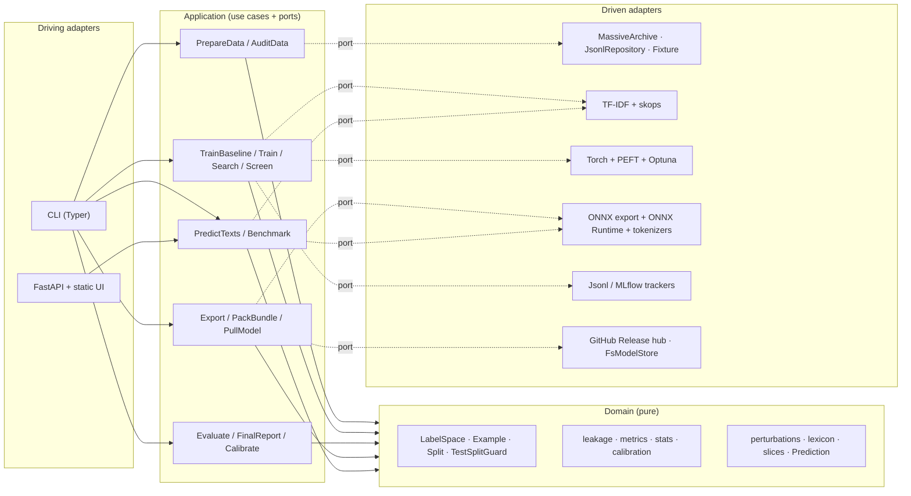
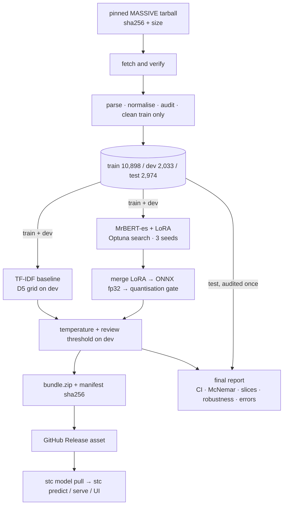

# Architecture

## Purpose and constraints

`spanish-text-classifier-lora` is a local-first Spanish virtual-assistant intent
classifier. It ships a CPU-only ONNX Runtime model behind a Typer CLI, a FastAPI
service and a static web UI. The architecture is a hexagonal (ports and
adapters) design: pure rules live in the domain, use cases depend on protocols,
and every I/O concern — files, sklearn, ONNX Runtime, HTTP, argparse — sits in an
adapter.

Binding constraints from the project plan (D1–D24):

- Python 3.12, `src/` layout, `mypy --strict` on `src/`, Ruff for lint/format.
- Runtime inference uses `onnxruntime` and `tokenizers`; `torch` is an optional
  training extra and must never be imported by the installed runtime.
- The test split is read only by two audited use cases, through a capability
  token and an append-only log.
- All artifacts are local: the pinned MASSIVE tarball is fetched and verified,
  weights are distributed through GitHub Releases and verified by sha256.
- Model selection, calibration and the quantisation gate use dev only; test is
  touched once per release candidate.

## Layers and dependency direction

```
stc.config · stc.logging · stc.bootstrap        (composition, outside the ring)
                    │
                    ▼
adapters  ──implements──▶  application  ──uses──▶  domain
(cli, api, data, models, inference, training,     (pure rules: no I/O)
 export, tracking, reporting, hub, storage, text, web)
```

`domain` may import only the standard library and NumPy. `application` may
import `domain` and its own ports/DTOs. `adapters` may import `application` and
`domain`, but never another adapter. `stc.bootstrap` is the composition root and
the only module allowed to wire adapters together; it imports heavy training
libraries lazily and raises `MissingExtraError` when the `train` extra is absent.



## Module map

One line per package; the named files are the entry points a newcomer should
open first.

- `src/stc/domain` — pure entities and rules: labels, examples, splits, leakage
  cleaning, metrics, statistics, calibration, perturbations, lexicon and slices.
  No file, network, model or settings access. Key files:
  `src/stc/domain/labels.py`, `src/stc/domain/leakage.py`,
  `src/stc/domain/metrics.py`, `src/stc/domain/calibration.py`.
- `src/stc/application` — ports (`src/stc/application/ports.py`) and frozen DTOs
  (`src/stc/application/dto.py`). It owns the dependency inversion of the whole
  project.
- `src/stc/application/use_cases` — orchestration: prepare and audit data, train
  the baseline and transformer, screen/search, evaluate, compose the final
  report, calibrate, export, pack/pull, predict and benchmark. Each use case
  receives ports through its constructor.
- `src/stc/application/services` — pure application helpers: `ClassifierFactory`
  (Strategy selection by artifact kind), `DevOnlyRepository` and
  `CalibratedClassifier` decorators, baseline/backbone selection rules,
  `ModelResolver` and `TrackerFactory`.
- `src/stc/adapters/data` — pinned MASSIVE archive download/verification, strict
  JSONL parsing, deterministic processed-split repository and the packaged
  fixture repository.
- `src/stc/adapters/text` — `HfTokenizer` over the Rust `tokenizers` file with
  right truncation and dynamic padding. Shared by training and inference.
- `src/stc/adapters/models` — TF-IDF + linear baseline trainer/classifier and the
  `skops` store with a type allow-list.
- `src/stc/adapters/inference` — manifest verification and safe zip handling
  (`src/stc/adapters/inference/bundle_io.py`) plus the torch-free
  `OnnxClassifier` (`src/stc/adapters/inference/onnx_classifier.py`).
- `src/stc/adapters/training` — the only package that imports torch,
  transformers, PEFT and Optuna: seeding, batching, LoRA/full-FT trainer,
  checkpoints, screening, TPE search and the tiny test backbone.
- `src/stc/adapters/export` — merged-LoRA ONNX export, parity check and the D12
  quantisation matrix with the binding quality gate.
- `src/stc/adapters/tracking` — JSONL, MLflow, Null Object and Composite
  experiment trackers.
- `src/stc/adapters/reporting` — deterministic JSON/CSV/Markdown writers,
  optional matplotlib figures and the results/summary renderer.
- `src/stc/adapters/hub` — committed model registry and the GitHub Release
  downloader with sha256 verification and offline refusal.
- `src/stc/adapters/storage` — installed model store and the append-only
  `reports/test_access_log.jsonl` writer.
- `src/stc/adapters/cli` — Typer app (`src/stc/adapters/cli/app.py`), command
  modules under `src/stc/adapters/cli/commands`, Rich rendering and D16 error
  mapping. The generated reference is `docs/CLI.md`.
- `src/stc/adapters/api` — FastAPI app factory, routes, Pydantic schemas,
  RFC 7807 handlers, request-id/security middleware and the classifier provider.
- `src/stc/adapters/web/static` — vanilla ES modules, CSS design tokens, ES/EN
  catalogues and the page served by `stc serve`; no build step and no CDN.
- `src/stc/config.py` — typed `STC_*` settings (D15) with the L5 loopback port
  range 19000–19999.
- `src/stc/logging.py` — structured logging; input texts are never logged.
- `src/stc/bootstrap.py` — composition root for settings, data, baseline,
  classifier factory, trackers, model store, report writer, API and training
  services.

## Ports and adapters

All ports are `typing.Protocol` definitions in
`src/stc/application/ports.py`; concrete adapters are injected by
`src/stc/bootstrap.py`. `Clock` is a small protocol in
`src/stc/domain/access.py` so timestamps are testable.

| Port | Responsibilities (sketch) | Adapters |
|---|---|---|
| `RawDatasetSource` | `fetch(dest, force) -> RawDatasetRef`, `verify(dest) -> sha256` | `MassiveArchiveSource` |
| `DatasetParser` | `parse(path) -> Mapping[Split, tuple[Example, ...]]` | `MassiveParser` |
| `DatasetRepository` | `load`, `save`, `meta`, `save_meta` | `JsonlDatasetRepository`, `FixtureRepository`; wrapped by `DevOnlyRepository` |
| `Tokenizer` | `max_length`, `encode_batch(texts) -> EncodedBatch` | `HfTokenizer` |
| `Classifier` | `info`, `labels`, `predict_scores(texts) -> float32[n, C]` | `TfidfLinearClassifier`, `OnnxClassifier` |
| `ClassifierTrainer` | `fit(train, dev, config, tracker) -> TrainedRun` | `LoraTrainer`, `FullFtTrainer` |
| `BaselineTrainer` | `evaluate_configs`, `fit` | `TfidfLinearTrainer` |
| `BaselineStore` | `save`, `load` with integrity metadata | `SkopsBaselineStore` |
| `HyperparameterSearcher` | `search(space, n_trials, resume) -> SearchResult` | `OptunaSearcher` |
| `ScreeningRunner` | `run() -> Sequence[ScreeningRun]` | `ScreeningRunner` adapter |
| `ModelExporter` | `export`, `score_logits`, `build_variant`, `gate`, `ship_variant` | `OnnxExporter` |
| `OnnxModelLoader` | `load(bundle, model_path, threads) -> Classifier` | `load_onnx_classifier` |
| `BundleArchive` | `verify`, `unpack`, `write_zip`, `refresh_manifest` | `BundleArchiveAdapter` |
| `ModelStore` | `save`, `load`, `list_installed`, `verify` | `FsModelStore` |
| `ModelHub` | `pull(entry, dest) -> Path` | `GithubReleaseHub` |
| `ExperimentTracker` | `start_run`, `log_params`, `log_metrics`, `log_artifact`, `end_run` | `JsonlTracker`, `MlflowTracker`, `NullTracker`, `CompositeTracker` |
| `JsonSink` / `ReportWriter` | deterministic JSON, CSV, Markdown and figures | `JsonReportWriter`, `CsvReportWriter`, `MarkdownReportWriter`, `CompositeReportWriter`, `PlotReportWriter` |
| `AccessLog` | `record(TestAccessEntry)` | `JsonlAccessLog` |

## Patterns in use

The plan names the patterns deliberately (D23); each row points to the code that
proves it exists rather than a diagram-only concept.

| Pattern | Class / function | File | Why it is used |
|---|---|---|---|
| Ports & Adapters (hexagonal) | `Classifier`, `DatasetRepository`, `ModelStore`, `ExperimentTracker` | `src/stc/application/ports.py` | Keep domain rules independent of sklearn, ONNX, HTTP and the filesystem. |
| Strategy | `TfidfLinearClassifier`, `OnnxClassifier` | `src/stc/adapters/models/tfidf_linear.py`, `src/stc/adapters/inference/onnx_classifier.py` | The same prediction use case scores either model without conditionals in the domain. |
| Factory | `ClassifierFactory`, `TrackerFactory` | `src/stc/application/services/classifier_factory.py`, `src/stc/application/services/tracker_factory.py` | Select an adapter from a manifest kind or a `--tracker` list at composition time. |
| Repository | `JsonlDatasetRepository`, `FixtureRepository`, `FsModelStore` | `src/stc/adapters/data/jsonl_repository.py`, `src/stc/adapters/data/fixture_source.py`, `src/stc/adapters/storage/fs_model_store.py` | Hide persistence and make the dataset/model source swappable and testable. |
| Decorator | `CalibratedClassifier`, `DevOnlyRepository` | `src/stc/application/services/calibrated_classifier.py`, `src/stc/application/services/dev_only_repository.py` | Add calibration/review flags or remove test access without changing the wrapped type. |
| Pipeline | `PrepareDataPipeline` | `src/stc/application/use_cases/prepare_data.py` | Fetch → verify → parse → audit → clean → persist is one explicit, resumable flow. |
| Composite | `CompositeTracker`, `CompositeReportWriter` | `src/stc/adapters/tracking/composite_tracker.py`, `src/stc/adapters/reporting/writers.py` | Fan one event or report out to JSONL and MLflow, or to JSON+CSV+Markdown, with error isolation. |
| Null Object | `NullTracker` | `src/stc/adapters/tracking/null_tracker.py` | Tests and smoke runs need a tracker without side effects. |
| Capability token | `TestAccessGrant`, `require_test_grant` | `src/stc/domain/access.py` | Test access is explicit, auditable and impossible to obtain by accident. |
| Composition root | `build_data_services`, `build_classifier_factory`, `build_tracker_factory`, `build_api_app` | `src/stc/bootstrap.py` | All wiring lives in one place, so adapters never import each other. |

## Configuration and composition root

Settings are a frozen `pydantic-settings` model with the `STC_` prefix
(`src/stc/config.py`). The important knobs are `STC_HOME`, `STC_DATA_DIR`,
`STC_MODEL`, `STC_THREADS`, `STC_OFFLINE`, `STC_TRACKER`, `STC_MLFLOW_URI`,
`STC_SEED`, `STC_API_HOST` and `STC_API_PORT` (default `19080`, constrained to
the 19000–19999 range so parallel local projects do not collide).
`stc doctor` prints the resolved values.

CLI commands construct services through `src/stc/bootstrap.py`; the API factory
receives its provider explicitly, and the UI is static files served by FastAPI.
Environment variables are read once per command, not at import time, which keeps
tests isolated.

## Data and inference lifecycle



Training reads only train and dev. The `FinalReport` use case and the audited
`stc evaluate --final` path are the only test readers; both require a
`TestAccessGrant` and append one `TestAccessEntry` to
`reports/test_access_log.jsonl`.

Inference is a separate, torch-free path: `stc model pull` verifies the release
sha256, `BundleArchiveAdapter` verifies every manifest file, and `OnnxClassifier`
loads `model.onnx`, `tokenizer.json`, `labels.json` and `calibration.json` into
ONNX Runtime. The CLI, API and UI all call the same `CalibratedClassifier`, so
`needs_review` is computed by one rule everywhere.

## Test pyramid

- `tests/unit` — fast, isolated tests for the domain (including Hypothesis
  properties), application use cases and each adapter. No network is used.
- `tests/integration` — CLI subprocess, FastAPI app and the full data pipeline,
  with tiny local fixtures.
- `tests/contract` — pinned external interfaces; for example the committed
  OpenAPI snapshot in `docs/openapi.json`.
- `tests/e2e` — Playwright drives the real UI served by the real API; marker
  `e2e`, skipped unless Chromium is installed.
- `tests/architecture` — import-linter plus an AST test that proves domain
  purity.
- `tests/docs` — link checker, ADR index/template, architecture path references,
  training-command existence and README/report drift guards.
- Torch-marked tests in `tests/unit/adapters` exercise the tiny trainer, search,
  screening and export paths; they need the `train` extra.

The task gate is:

```bash
uv run ruff check . && uv run ruff format --check . && uv run mypy src && uv run lint-imports
uv run pytest -q -m "not e2e and not torch"
uv run pytest -q -m torch   # with the train extra
uv run pytest -q -m e2e     # after Playwright install
```

Coverage is enforced at 85 % on `src/stc` in CI (`--cov=src/stc`), with the
optional torch modules included in the `test-torch` job.

## How the boundaries are enforced

`pyproject.toml` declares seven import-linter contracts, run by
`uv run lint-imports`:

1. `layers`: `stc.adapters` → `stc.application` → `stc.domain`.
2. `stc.domain` may not import `stc.application`, `stc.adapters` or `stc.config`.
3. `stc.domain` may not import third-party libraries (sklearn, scipy, torch,
   onnxruntime, fastapi, typer, pydantic, tokenizers, skops, mlflow, optuna,
   transformers, peft, matplotlib, structlog, rich, platformdirs).
4. `stc.application` may not import `stc.adapters`.
5. `stc.application` may not import the same third-party libraries.
6. Runtime packages (domain, application, inference, CLI, API, data, models, hub,
   storage, text, reporting) may not import torch, transformers, peft, optuna,
   mlflow or onnx.
7. Adapters are independent; only `src/stc/bootstrap.py` may import them
   together, and the contract records those wires explicitly.

`tests/architecture/test_layers.py` adds a custom AST test: every module under
`src/stc/domain` imports only the standard library, NumPy and other domain
modules. CI runs the same commands, so a boundary violation fails locally and
remotely in the same way.

## Extension recipes

**Add a classifier adapter.** Create a class that satisfies `Classifier`
(`info`, `labels`, `predict_scores`) under the appropriate
`src/stc/adapters` package. Keep heavy imports lazy. Register a builder in
`build_classifier_factory` in `src/stc/bootstrap.py` under the manifest `kind`
it serves. Add the bundle layout/verification in
`src/stc/adapters/inference/bundle_io.py` if the artifact is new, then add unit
tests, a `ClassifierFactory` test, and a section in `docs/API.md` or `docs/CLI.md`
only if the user-facing surface changes. Update this table and the ports table.

**Add a perturbation.** Implement a pure function in
`src/stc/domain/perturbations.py`, add it to the `PERTURBATIONS` registry with a
name that the report uses, and add Hypothesis/unit tests in
`tests/unit/domain/test_perturbations.py`. The robustness use case iterates over
the registry and the report schema carries the new name automatically. If the
perturbation is a dialect lexicon, extend `src/stc/domain/lexicon.py` and keep
the synthetic-dialect disclaimer in `docs/EVALUATION.md` and ADR-0009.

**Add a dataset.** Implement `RawDatasetSource` and `DatasetParser` for the new
format, then wire them in `build_data_services` (`src/stc/bootstrap.py`) and
`PrepareDataPipeline` (`src/stc/application/use_cases/prepare_data.py`). A new
dataset must keep the train/dev/test roles, pass the leakage audit, and use the
same label-space rules (sorted intents, scenario = intent prefix). Record the
source, licence and checksums in `docs/DATA.md`, add a regression test, and
re-run the full evaluation; changing the dataset is a Spec-level decision, not a
configuration toggle.

## Related documents

- `docs/DATA.md` — source, licence, lineage and cleaning policy.
- `docs/EVALUATION.md` — split protocol, formulas and report guide.
- `docs/TRAINING.md` — GPU setup, measured commands and troubleshooting.
- `docs/CLI.md` — generated command reference.
- `docs/API.md` — endpoint guide and error model.
- `docs/adr/README.md` — decision-record index.
- `docs/ERROR_ANALYSIS.md` — qualitative error study.
