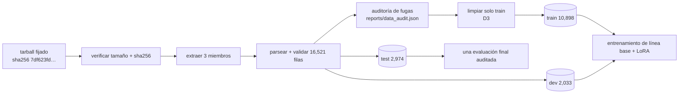

# Datos: fuentes, licencias, linaje y limpieza

Este proyecto entrena y evalúa con **Amazon MASSIVE 1.0, locale `es-ES`**. Todo lo que sigue es
reproducible a partir del archivo fijado y de los comandos versionados; ningún archivo de datos se
versiona en git, salvo la pequeña muestra CC BY 4.0 en `src/stc/_fixture/massive_es_sample/`.

## Fuente fijada

| Campo | Valor |
|---|---|
| Conjunto de datos | Amazon MASSIVE 1.0 (`es-ES`), localizado por personas a partir de SLURP |
| URL del tarball | `https://amazon-massive-nlu-dataset.s3.amazonaws.com/amazon-massive-dataset-1.0.tar.gz` |
| Tamaño del tarball | 39,500,415 bytes |
| sha256 del tarball | `7df623fd2d300a4d235d6ee5bd396c9a28258d3a0ccb29abdb054506eba153f8` |
| Miembros extraídos | `1.0/data/es-ES.jsonl`, `1.0/LICENSE`, `1.0/NOTICE.md` |
| Filas | 11,514 train / 2,033 dev / 2,974 test = 16,521 |
| Etiquetas | 60 intenciones, 18 escenarios (`scenario` = prefijo de la intención antes del primer `_`) |
| Licencia | CC BY 4.0, Copyright Amazon.com Inc. |

Las constantes viven en `src/stc/adapters/data/massive_archive.py`. La descarga escribe un archivo
`.part`, comprueba el número de bytes y después el sha256, y extrae solo los tres archivos regulares
de la lista de permitidos. Ante una discrepancia de checksum no se extrae nada. Un espejo corrupto no
puede escapar del directorio de destino: se rechazan las rutas absolutas, los componentes `..`, las
barras invertidas y los enlaces. Un archivo `VERIFIED` registra el sha256 aceptado, y `stc data fetch`
pasa a ser un acierto de caché sin acceso a la red.

```bash
uv run stc data fetch          # sha256 OK 7df623fd…153f8
uv run stc data verify         # re-hashes the cached archive
uv run stc data prepare        # train=10898 dev=2033 test=2974 dropped=616
uv run stc data audit --out reports
```

Los datos viven bajo `${STC_DATA_DIR:-${STC_HOME:-<platform data dir>}/data}`:

```
data/raw/massive-1.0/{es-ES.jsonl,LICENSE,NOTICE.md,VERIFIED}
data/raw/massive-1.0.tar.gz
data/processed/massive-1.0/{train,dev,test}.jsonl, meta.json
```

## Licencias y atribución

- **MASSIVE**: CC BY 4.0, Copyright Amazon.com Inc. Ver el `LICENSE` y el `NOTICE.md` del archivo, y el
  `NOTICE` del proyecto.
- **SLURP** (corpus original en inglés): CC BY 4.0.
- La muestra incluida (fixture) se redistribuye bajo CC BY 4.0 con la misma atribución; su `NOTICE.md`
  indica que el proyecto seleccionó y reformateó las filas.

## Licencias de los modelos base

Los modelos base se descargan del Hugging Face Hub al ejecutar el entrenamiento o el screening; sus
pesos no se versionan en este repositorio. Solo MrBERT-es tiene su licencia declarada en un archivo del
repositorio (`NOTICE`, `MODEL_CARD.md`). Los dos modelos de screening no tienen declaración de licencia
en este repositorio, así que sus filas remiten a la model card de origen en lugar de repetir una
licencia.

| Modelo | Rol en este repositorio | Licencia | Fuente |
|---|---|---|---|
| `BSC-LT/MrBERT-es` | Backbone publicado, ajustado con LoRA | Apache-2.0 (`NOTICE`, `MODEL_CARD.md`) | https://huggingface.co/BSC-LT/MrBERT-es |
| `bertin-project/bertin-roberta-base-spanish` | Candidato de screening (`configs/screening.toml`) | Ver la model card en https://huggingface.co/bertin-project/bertin-roberta-base-spanish | Ídem |
| `Qwen/Qwen3-0.6B` | Solo candidato de screening; nunca se selecciona ni se exporta (`backbone_selection.py`) | Ver la model card en https://huggingface.co/Qwen/Qwen3-0.6B | Ídem |

## Linaje



## Roles de las particiones

- **train** — solo para ajustar, tras la política de limpieza que se describe más abajo.
- **dev** — todas las decisiones de búsqueda y selección (hiperparámetros, backbone, semilla del modelo,
  temperatura y umbral de revisión, puerta de cuantización).
- **test** — una evaluación final auditada por release candidate, tras un `TestAccessGrant`; cada lectura
  añade una línea a `reports/test_access_log.jsonl`.

Ver [ADR-0004](adr/0004-evaluation-protocol-and-leakage-policy.md).

## Política de limpieza (decisión D3)

`normalize_for_dedup` = `casefold → NFKD → quitar marcas combinantes → quitar [^\w\s] → colapsar espacios → strip`.
Train se ordena por id entero y:

1. se eliminan las filas cuyo texto normalizado aparece en dev o test (`OVERLAP_WITH_EVAL`);
2. se eliminan completos los grupos cuyo texto normalizado tiene más de una intención
   (`LABEL_CONFLICT_DUPLICATE`);
3. los demás grupos de duplicados conservan el id más bajo (`EXACT_DUPLICATE` para el resto).

Dev y test **nunca** se modifican. El `worker_id` del traductor no puede usarse para reagrupar: 19 de
20 workers aparecen en más de una partición.

Medido con `uv run stc data audit --out reports`:

| Partición | Filas originales | Filas procesadas |
|---|---:|---:|
| train | 11,514 | 10,898 |
| dev | 2,033 | 2,033 |
| test | 2,974 | 2,974 |

| Campo de auditoría | Valor |
|---|---:|
| Textos normalizados solapados dev∩test | 45 |
| Filas de dev también presentes en train | 123 (7 con conflicto de etiquetas) |
| Filas de test también presentes en train | 152 (6 con conflicto de etiquetas) |
| Grupos de duplicados en train | 264 (384 filas sobrantes) |
| Grupos con conflicto de etiquetas en train (tras quitar solapamientos) | 19 |
| Grupos de duplicados en dev / test | 18 / 31 |
| Eliminaciones: solapamiento / conflicto de etiquetas / exactas | 356 / 43 / 217 |
| Train tras la limpieza | 10,898 |

`reports/data_audit.json` contiene todos los números y los ids eliminados por motivo;
`reports/data_audit.md` es el resumen legible para personas.

## Muestra incluida (decisión D24)

`scripts/make_fixture.py` selecciona, por intención, hasta 6 filas de train, 2 de dev y 2 de test,
ordenadas por `sha256(id)` ascendente a partir de las particiones procesadas. La muestra actual tiene
358 / 118 / 117 filas (593 en total, 74,858 bytes de JSONL), cubre las 60 intenciones en train y se
distribuye con `LICENSE-CC-BY-4.0.txt` y `NOTICE.md`. Ejecutar el script dos veces produce archivos
idénticos byte a byte:

```bash
uv run python scripts/make_fixture.py
uv run stc data fixture info   # train 358 / dev 118 / test 117
```

La muestra versionada es estable byte a byte (`scripts/make_fixture.py` es determinista). Sus
checksums son:

| Archivo | Bytes | sha256 |
|---|---:|---|
| `train.jsonl` | 45,054 | `d3d013ccb385cd38085c5728c43cd3bb3ccedf112dd61b6ac57ae82165cf8f59` |
| `dev.jsonl` | 14,966 | `4cbcfff75ab4ca4ff8ef6c5d497f1c04baeeebe4fccd2fffa020624de830aea3` |
| `test.jsonl` | 14,838 | `568277f04c7996086d5a4d45328de7898c7cb06b64840dc5698658c94ed502b8` |
| `LICENSE-CC-BY-4.0.txt` | — | `c2e6ea015269147de02117ebdd91f30ef09831251f5345fa8365273b1db1d435` |
| `NOTICE.md` | — | `35a6c6e009ae9e302da75762e2d7e3b58d1569176ee50bed984d94ca8c530977` |

Los dos reportes de auditoría los genera `uv run stc data audit --out reports`: `reports/data_audit.json`
es el registro legible por máquinas (conteos originales y procesados, campos de solapamiento,
conteos de eliminación e ids eliminados por motivo), y `reports/data_audit.md` es su versión legible
para personas. Vuelve a ejecutar el comando en lugar de editar cualquiera de los dos archivos.

## Candidatos descartados

| Candidato | Motivo |
|---|---|
| MeLiSA | Licencia "other" ligada a un acuerdo con Amazon; solo demostración. |
| TASS / InterTASS | Sin declaración de licencia; tuits solo para investigación. |
| MLSUM (es) | Términos no comerciales; solo España. |
| XL-Sum | CC BY-NC-SA 4.0. |
| SIB-200 | Siete clases temáticas; demasiado pequeño. |
| WikiCAT_es v2 | Etiquetas derivadas automáticamente; licencia inconsistente. |
| MTEB SpanishNewsClassification | Procedencia original no verificable. |
| `cardiffnlp` tweet sentiment | Sin metadatos de licencia. |

## Aviso sobre dialectos sintéticos

MASSIVE no tiene un locale de español latinoamericano. El reporte de robustez aplica sustituciones
**sintéticas** de México, Ecuador y el rioplatense (léxico y voseo) al conjunto de test. Es una sonda
de sensibilidad a la fragilidad léxica, no evidencia de precisión real en LatAm, y está etiquetada como
sintética en el README, la model card, los reportes y la
[ADR-0009](adr/0009-synthetic-dialect-robustness.md).
