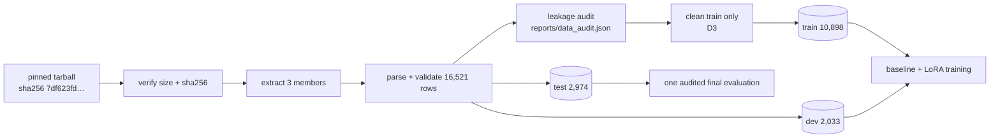

# Data: sources, licences, lineage and cleaning

This project trains and evaluates on **Amazon MASSIVE 1.0, locale `es-ES`**.
Everything below is reproducible from the pinned archive and the committed
commands; no dataset file is tracked in git except the small CC BY 4.0 sample
in `src/stc/_fixture/massive_es_sample/`.

## Pinned source

| Field | Value |
|---|---|
| Dataset | Amazon MASSIVE 1.0 (`es-ES`), human-localised from SLURP |
| Tarball URL | `https://amazon-massive-nlu-dataset.s3.amazonaws.com/amazon-massive-dataset-1.0.tar.gz` |
| Tarball size | 39,500,415 bytes |
| Tarball sha256 | `7df623fd2d300a4d235d6ee5bd396c9a28258d3a0ccb29abdb054506eba153f8` |
| Extracted members | `1.0/data/es-ES.jsonl`, `1.0/LICENSE`, `1.0/NOTICE.md` |
| Rows | 11,514 train / 2,033 dev / 2,974 test = 16,521 |
| Labels | 60 intents, 18 scenarios (`scenario` = intent prefix before the first `_`) |
| Licence | CC BY 4.0, Copyright Amazon.com Inc. |

The constants live in `src/stc/adapters/data/massive_archive.py`; the download
writes a `.part` file, checks the byte count and then the sha256, and extracts
only the three allow-listed regular files. On a checksum mismatch nothing is
extracted. A corrupt mirror cannot escape the destination directory: absolute
paths, `..` components, backslashes and links are rejected. A `VERIFIED` file
records the accepted sha256, and `stc data fetch` becomes a cache hit with no
network access.

```bash
uv run stc data fetch          # sha256 OK 7df623fd…153f8
uv run stc data verify         # re-hashes the cached archive
uv run stc data prepare        # train=10898 dev=2033 test=2974 dropped=616
uv run stc data audit --out reports
```

Data lives under `${STC_DATA_DIR:-${STC_HOME:-<platform data dir>}/data}`:

```
data/raw/massive-1.0/{es-ES.jsonl,LICENSE,NOTICE.md,VERIFIED}
data/raw/massive-1.0.tar.gz
data/processed/massive-1.0/{train,dev,test}.jsonl, meta.json
```

## Licences and attribution

- **MASSIVE**: CC BY 4.0, Copyright Amazon.com Inc. See the archive's `LICENSE`
  and `NOTICE.md`, and the project `NOTICE`.
- **SLURP** (upstream English corpus): CC BY 4.0.
- The bundled fixture sample is redistributed under CC BY 4.0 with the same
  attribution; its `NOTICE.md` states that the project selected and reformatted
  the rows.

## Lineage



## Split roles

- **train** — fitting only, after the cleaning policy below.
- **dev** — every search and selection decision (hyper-parameters, backbone,
  model seed, temperature and review threshold, quantisation gate).
- **test** — one audited final evaluation per release candidate, behind
  `TestAccessGrant`; every read appends a line to
  `reports/test_access_log.jsonl`.

See [ADR-0004](adr/0004-evaluation-protocol-and-leakage-policy.md).

## Cleaning policy (decision D3)

`normalize_for_dedup` = `casefold → NFKD → drop combining marks → remove
[^\w\s] → collapse whitespace → strip`. Train is sorted by integer id and:

1. rows whose normalised text appears in dev or test are dropped
   (`OVERLAP_WITH_EVAL`);
2. groups whose normalised text carries more than one intent are dropped whole
   (`LABEL_CONFLICT_DUPLICATE`);
3. other duplicate groups keep the lowest id (`EXACT_DUPLICATE` for the rest).

Dev and test are **never** modified. Translator `worker_id` cannot be used to
regroup: 19 of 20 workers appear in more than one partition.

Measured by `uv run stc data audit --out reports`:

| Split | Raw rows | Processed rows |
|---|---:|---:|
| train | 11,514 | 10,898 |
| dev | 2,033 | 2,033 |
| test | 2,974 | 2,974 |

| Audit field | Value |
|---|---:|
| Dev∩test normalised overlap texts | 45 |
| Dev rows also in train | 123 (7 label-conflicting) |
| Test rows also in train | 152 (6 label-conflicting) |
| Train duplicate groups | 264 (384 excess rows) |
| Train label-conflict groups (after overlap removal) | 19 |
| Dev / test duplicate groups | 18 / 31 |
| Drops: overlap / label-conflict / exact | 356 / 43 / 217 |
| Train after cleaning | 10,898 |

`reports/data_audit.json` contains every number plus the dropped ids by reason;
`reports/data_audit.md` is the human-readable companion.

## Bundled fixture (decision D24)

`scripts/make_fixture.py` selects, per intent, up to 6 train / 2 dev / 2 test
rows by ascending `sha256(id)` from the processed splits. The current sample has
358 / 118 / 117 rows (593 total, 74,858 bytes of JSONL), covers all 60 intents
in train and ships with `LICENSE-CC-BY-4.0.txt` and `NOTICE.md`. Running the
script twice produces byte-identical files:

```bash
uv run python scripts/make_fixture.py
uv run stc data fixture info   # train 358 / dev 118 / test 117
```

## Rejected candidates

| Candidate | Reason |
|---|---|
| MeLiSA | Licence "other" tied to an Amazon agreement; demo-only. |
| TASS / InterTASS | No licence statement; research-only tweets. |
| MLSUM (es) | Non-commercial terms; Spain-only. |
| XL-Sum | CC BY-NC-SA 4.0. |
| SIB-200 | Seven topic classes, too small. |
| WikiCAT_es v2 | Automatically derived labels; inconsistent licence. |
| MTEB SpanishNewsClassification | Upstream provenance unverifiable. |
| `cardiffnlp` tweet sentiment | No licence metadata. |

## Synthetic dialect disclaimer

MASSIVE has no Latin-American Spanish locale. The robustness report applies
**synthetic** Mexico, Ecuador and Rioplatense substitutions (lexicon and voseo)
to the test split. This is a sensitivity probe of lexical brittleness, not
evidence of real LatAm accuracy, and it is labelled synthetic in the README,
model card, reports and [ADR-0009](adr/0009-synthetic-dialect-robustness.md).
